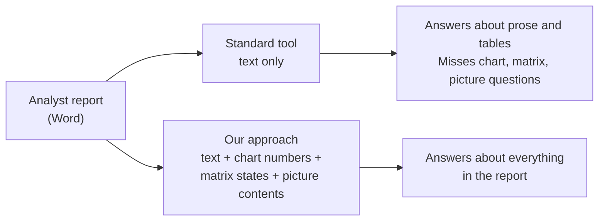
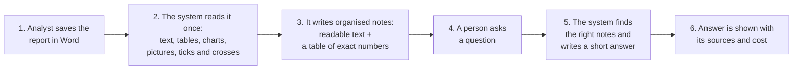
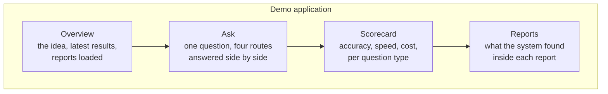

# Ask our research reports: executive overview

*For leadership. No technical background needed. The engineering view is in [TECHNICAL_ARCHITECTURE.md](TECHNICAL_ARCHITECTURE.md); the proposal for what to do next is in [NEXT_STEPS.md](NEXT_STEPS.md).*

---

## 1. The idea in one minute

Our analysts publish research reports as Word documents. Much of the value sits in places that are hard to search:
**numbers inside charts, ticks and crosses in comparison tables, and photographs or screenshots.**

This prototype lets anyone **type a question in plain English and get a short, exact answer with the source shown**:

| Someone asks | The system answers from |
|---|---|
| "What is the 2030 value for Germany in Fig 27?" | the numbers behind a chart |
| "Is feature X available at provider Y?" | a tick/cross comparison table |
| "How many employees work at the Wakefield site?" | text printed on a picture |
| "How did the view change between the April and July edition?" | two reports read together |
| "What will the Bank of England do in March?" (not in any report) | **"The documents do not say."**, it does not guess |

Two promises matter most to us: **answers are traceable** (every answer points to the passage it came from) and
**the system admits when the reports do not contain the answer.**

---

## 2. What problem are we solving, and why not just use a standard tool?

Standard "chat with your documents" tools turn a Word file into plain text first. In that step, **anything that is a
picture is lost**, and in analyst reports a large part of the content *is* pictures: charts pasted from Excel,
tick/cross matrices, photographs.

**What we measured (Phase 0, sample of four real reports, 71 answerable test questions):**

| | Standard conversion | Our approach |
|---|---|---|
| Questions whose answer survived conversion | 52 of 71 (73%) | **71 of 71 (100%)** |
| Charts pasted as pictures turned into numbers | 0 | 121 of 135 (the rest are sent to a vision model) |
| Cost of reading charts at question time | high (vision model on each question) | near zero (numbers read once, when the report is added) |

Every loss in the standard conversion was a chart, a comparison table or a picture. Those are exactly the questions
people find hardest to answer by hand.

---

## 3. How it works, in plain language

Think of it as a librarian who **reads every report once, carefully, and keeps organised notes**, then answers
questions from those notes and always shows the page.

1. **Add a report.** Upload the Word file. Nothing else is needed from the analyst.
2. **Read it once.** The system reads text, tables and headings, reads the numbers out of charts, recognises
   ticks and crosses (and their colour), and has an AI model describe each picture once.
3. **Keep notes.** It stores readable text for searching *and* a precise table of numbers and states for exact
   look-ups ("what was the value in 2030").
4. **Ask.** Any employee asks in plain language.
5. **Answer.** An AI assistant looks up the notes, checks exact numbers where needed, and writes a short answer. It is
   instructed never to answer from general knowledge, only from our reports.
6. **Show the evidence.** The answer lists the passages it used, how long it took, and what it cost.

---

## 4. What you can see in the demo

A web application with four pages. Each page is built so a non-specialist can follow it, with the detail one click
deeper.

| Page | What it shows | The point for the audience |
|---|---|---|
| **Overview** | The question we are answering, key results in a few numbers, the reports in the system | The business case on one screen |
| **Ask** | One question answered at the same moment by four "routes" (see below), each showing answer, seconds, tokens, cost, sources. Eight ready-made questions with the correct answer displayed so the audience can judge live | Seeing is believing: the difference in answers is visible |
| **Scorecard** | Results of the full test set: accuracy, whether the right evidence was found, speed, cost, split by type of question | Evidence rather than anecdotes |
| **Reports** | For each report: charts redrawn from the extracted numbers, pictures with their descriptions, what a plain conversion would have seen | Trust: you can see what the system understood |

**The four routes compared in the Ask page**

| | Plain Word conversion | Our enhanced conversion |
|---|---|---|
| **Quick mode** (one search, one answer) | Route 1 | Route 2 |
| **Assistant mode** (an AI assistant plans several searches and uses extra tools) | Route 3 | Route 4 |

"Plain Word conversion" is what Microsoft (or any standard tool) gives out of the box. "Enhanced" is our approach.
Putting them side by side answers the executive question *"do we need to build anything, or can we buy it?"*

---

## 5. Everything the system can do today

| Capability | In plain terms |
|---|---|
| **Answer questions from reports** | Short, exact, in plain English |
| **Cite sources** | Every answer shows the passages used |
| **Read charts as numbers** | Including charts that were pasted into Word as pictures |
| **Read comparison matrices** | Understands tick vs cross and colour |
| **Understand pictures** | Reads printed text, counts and labels in photographs and screenshots, once, at load time |
| **Compare reports** | Questions spanning two editions ("how did the view change?") |
| **Say "I don't know"** | Answers exactly "The documents do not say." when it is not in the reports |
| **Follow-up questions** | Keeps the conversation going in assistant mode |
| **Show cost and speed** | Seconds, tokens and money per question |
| **Self-test** | 122 verified test questions are scored automatically by a separate AI judge |
| **Prove nothing was lost** | A no-AI check confirms every fact needed is present in the converted text |
| **Add or remove a report** | One command each; removal cleans up everywhere |
| **Control who sees what** | Per-report access lists, enforced when answering (switched on by adding one file) |
| **Run in two environments** | Fully on Azure services, or on a single laptop, selected by one setting |

---

## 6. Why we can trust the numbers

- **A verified test set.** 122 questions across the four reports, each with the correct answer and the exact text
  it comes from. Every answer was checked against the converted reports, and every picture question by looking at the
  picture.
- **An independent judge.** A separate AI model compares each system answer with the correct one using the same
  rules for every route.
- **Honest about what is not yet proven.** The test set was checked against the Word files, not yet against the
  published PDFs; an analyst should sign it off before wider use. See [NEXT_STEPS.md](NEXT_STEPS.md).

---

## 7. Safety, privacy and control

| Concern | How it is handled today |
|---|---|
| **Made-up answers** | The assistant is instructed to answer only from the reports and cite them; unanswerable questions are part of the test set |
| **Where data lives** | One storage container in our own Azure subscription; nothing is needed on laptops except sign-in settings |
| **Sign-in** | Microsoft Entra ID (single sign-on) by default; no passwords or keys in the code |
| **Who sees which report** | Optional per-report access lists, enforced in every retrieval path |
| **Deleting a report** | Removing the file and running one clean-up command removes it from storage and from every search index |
| **Cost control** | Every question's cost is shown; charts are read once at load time, not at every question |

---

## 8. What this is and is not

**It is** a working prototype on four real reports that demonstrates the approach, measures it, and compares it
with the off-the-shelf alternative.

**It is not yet** a production service: it has not been tested with hundreds of reports, real user load, formal
security review, or analyst sign-off on the test set.

---

## 9. The decision we are asking leadership to take

Whether to proceed from prototype to a **pilot with real users on a larger set of reports**, and with which
sponsor. The proposed path, budget drivers and risks are in [NEXT_STEPS.md](NEXT_STEPS.md).

---

## Glossary (plain English)

| Term | Meaning |
|---|---|
| **AI assistant / agent** | An AI that can plan several searches and use tools before answering |
| **Markdown+** | Our enhanced text version of a report, containing chart numbers and picture descriptions as well as the words |
| **Token** | The unit AI models charge by, roughly three quarters of a word |
| **Vision model** | An AI model that can look at a picture |
| **Judge** | A separate AI model that marks answers right or wrong against the verified answer |
| **Golden set** | The 122 verified questions used as the exam |
