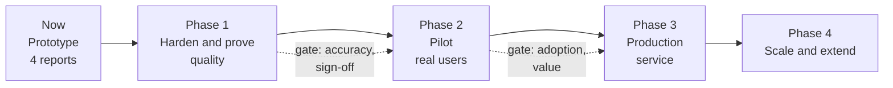

# Next steps: from prototype to pilot to service

*Proposal for discussion. Companion to [EXECUTIVE_OVERVIEW.md](EXECUTIVE_OVERVIEW.md) and
[TECHNICAL_ARCHITECTURE.md](TECHNICAL_ARCHITECTURE.md). Phases are ordered by dependency, not by calendar; dates
and budgets are to be set with the sponsor.*

## 1. Where we are

| Area | Status |
|---|---|
| Approach proven on 4 real reports | Done: 71 of 71 answerable evidence items survive conversion vs 52 of 71 with a standard tool |
| Comparison vs off-the-shelf | Built: 2 inputs x 2 modes x 2 engines on identical questions |
| Test set | 122 verified questions (engineer-verified, not yet analyst-signed) |
| Demo | 4-page application, live side-by-side |
| Operations | Add / remove report, reconcile, retention check, runbook |
| Access control | Per-report lists, configuration-driven |
| Production readiness | Not yet: scale, security review, monitoring, user feedback loop |

## 2. The decision

**Recommendation:** approve a time-boxed **pilot** with one business sponsor, one real user group and a larger
report set, with explicit success criteria (section 5). Continue only if the criteria are met.

## 3. Roadmap

### Phase 1: Harden and prove quality

| # | Work | Why | Output |
|---|---|---|---|
| 1.1 | Analyst sign-off of the 122-question set against published PDFs; add questions from real analyst/sales queries | The exam must be trusted | Signed golden set v1.1 |
| 1.2 | Record the reference runs on both engines (`baseline-azure`, `baseline-langchain`), generate `report --k 10`, fill [audit/01-baseline.md](audit/01-baseline.md) | Before/after numbers for every later change | Baseline tables |
| 1.3 | Close extractor gaps from the loss report: comments, tracked deletions, footers, header content, figure caption linking, charts with external workbook only | Nine known losses | Fixtures turn from xfail to pass |
| 1.4 | Extend corpus to 25 to 50 reports across formats and authors | Four reports cannot show variance | Ingest success rate, per-report manifest warnings |
| 1.5 | Retrieval quality experiments (reranker, figure boost, chunk sizes), each an A/B on the golden set | Evidence-driven tuning | Decision table |
| 1.6 | Replace configured principals with identity from the signed-in user's Entra token and groups | Real access control | Security-reviewed ACL |
| 1.7 | Security and privacy review (data classification, private endpoints, no key auth, logging of prompts) | Gate for real users | Review sign-off |

**Exit criteria:** accuracy on the signed-off set at or above the agreed target on both Markdown+ routes; every
unanswerable question refused correctly; ingest succeeds on at least 95% of the larger corpus; security review passed.

### Phase 2: Pilot

| # | Work | Output |
|---|---|---|
| 2.1 | Deploy a hosted, authenticated web app (Azure Container Apps or App Service) in place of laptop-run Streamlit | URL for pilot users |
| 2.2 | In-app feedback (thumbs, wrong-answer flag, free text) stored with question, answer and sources | Real-world quality signal |
| 2.3 | Usage telemetry (Application Insights): questions, latency p50/p95, tokens, refusals | Dashboard |
| 2.4 | Automated ingestion on upload (storage event triggers ingest and index) with failure alerts | No manual steps for analysts |
| 2.5 | Weekly regression run of the golden set plus new questions harvested from feedback | Quality never silently drops |
| 2.6 | 10 to 30 pilot users from one team; structured interviews at the midpoint and end | Adoption evidence |

**Exit criteria:** see section 5.

### Phase 3: Production

| # | Work |
|---|---|
| 3.1 | Infrastructure as code (Bicep or Terraform), environments (dev, test, prod), CI/CD with the golden-set run as a quality gate |
| 3.2 | Private networking, managed identities, key management, backup and recovery for the store; defined RTO/RPO |
| 3.3 | Choose the engine: Azure AI Search tier sized for the largest Word file (or rely on Markdown+ only), or LangChain on a managed vector store |
| 3.4 | Service levels, support model, on-call, runbooks for ingest failures and model deprecations |
| 3.5 | Model governance: pinned model versions, content-safety settings, re-evaluation before every model change |
| 3.6 | Usage controls: prompt/response caching, token quotas per user group |

### Phase 4: Scale and extend (options, sequenced by value)

| Option | Value | Note |
|---|---|---|
| More input formats (PDF, PowerPoint, Excel) through the same plugin approach | Whole research library | MarkItDown already handles other formats; the plugin work is per format |
| Structured facts layer in a table (SQL / Fabric) and natural-language-to-SQL | Exact cross-report numeric questions | Facts file is already the start |
| Entity and theme analysis over hundreds of reports (graph approach) | "What are the themes across the library?" | Revisit when corpus is in the hundreds; see DESIGN 3.9 |
| Integration into where people work (Teams, Copilot, CRM) | Adoption | After pilot proves value |
| Multilingual reports and questions | Reach | Evaluate embeddings and judge per language |
| Alerts and summaries ("what changed since last edition") | Proactive value | Builds on cross-document questions |

## 4. Risks and mitigations

| Risk | Likelihood | Impact | Mitigation |
|---|---|---|---|
| Quality on a broader corpus is lower than on four reports | Medium | High | Phase 1.4 and 1.5 before any user exposure; gate on accuracy |
| Test set is biased because engineers wrote it | Medium | High | Analyst sign-off and real-user questions (1.1, 2.2) |
| Model deprecation alters results | Medium | Medium | Pinned versions, regression run on every change |
| Sensitive reports visible to the wrong people | Low if 1.6 done | High | Entra-based ACL, security review, audit logs |
| Hallucinated answer reaches a client | Low | High | Cite-or-refuse instruction, unanswerable tests, visible sources, feedback flag, pilot users internal only |
| Service tier limits skip large reports | Known | Medium | Markdown+ path has no size limit; size the tier or drop the Word arm in production |
| Token use and latency grow with the agentic mode | Medium | Medium | Single-pass as default, agentic for hard questions, tokens and seconds already measured per question |
| Analyst formatting varies (new templates) | Medium | Medium | Manifest warnings, loss-report fixtures, retention check on every ingest |
| Key-person dependency on the extractor | Medium | Medium | Documentation (this set), tests, hand-over sessions |

## 5. Proposed pilot success criteria

To be agreed with the sponsor; the numbers below are placeholders.

| Dimension | Measure | Target |
|---|---|---|
| Accuracy | Judge score on signed-off golden set | to agree (for example 90% or higher) |
| Safety | Unanswerable questions correctly refused | 100% |
| Grounding | Answers with at least one correct source | to agree |
| Speed | p95 seconds to answer (single-pass mode) | to agree (prototype single-pass mode is about 3 s typical) |
| Efficiency | Tokens per question | to agree, from the measured token counts |
| Adoption | Weekly active pilot users; questions per user | to agree |
| Value | Self-reported time saved; share of answers marked useful | to agree |
| Trust | Share of answers flagged wrong by users | to agree |

## 6. Resource drivers (no figures committed)

| Driver | What moves it |
|---|---|
| One-off ingest per report | Number of pictures needing vision, model choice; cached by content hash so re-runs are free |
| Per question | Mode (single-pass vs agentic), reasoning effort, passages retrieved, pictures attached |
| Platform | AI Search tier and replicas (or vector store), storage, hosting, monitoring |
| People | Analyst time for sign-off and feedback review; engineering for hardening and operations |

The system already reports tokens by kind and seconds per question, so these can be sized from measured data after Phase 1.2.

## 7. What we need from leadership

1. A **business sponsor** and a pilot team.
2. **Access to a larger sample** of real reports (and a data-classification ruling for them).
3. **Analyst time** for the sign-off and pilot feedback.
4. **Security and architecture review slots** in Phase 1.
5. Agreement on **success criteria** and a **go / no-go date** for the end of the pilot.

## 8. Immediate actions (next two weeks of work, in order)

1. Run the two baseline evaluations and publish the tables.
2. Restart the app and re-run any evaluation rows recorded with zero single-pass-mode tokens (`--redo`).
3. Schedule the analyst review of the golden set.
4. Request the larger report sample and the security review.
5. Agree pilot scope, sponsor and success criteria.
