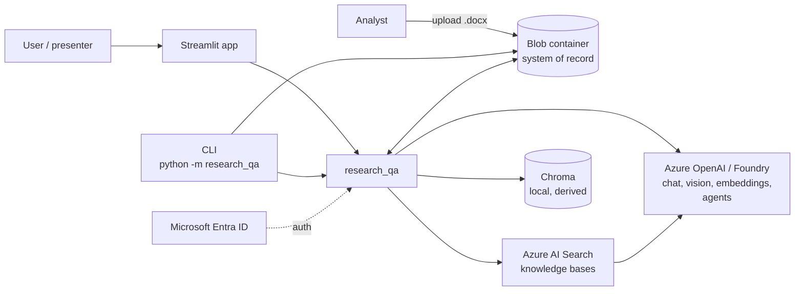
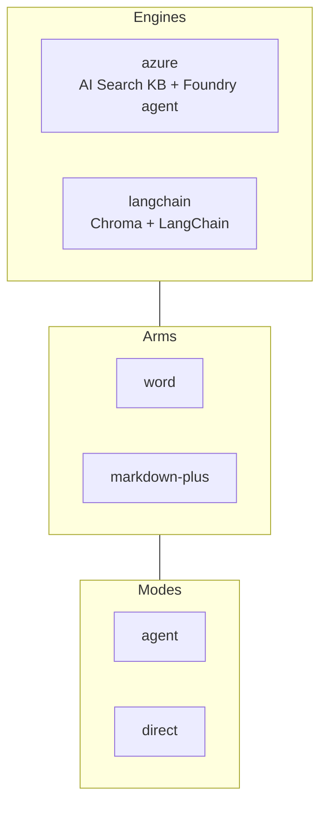
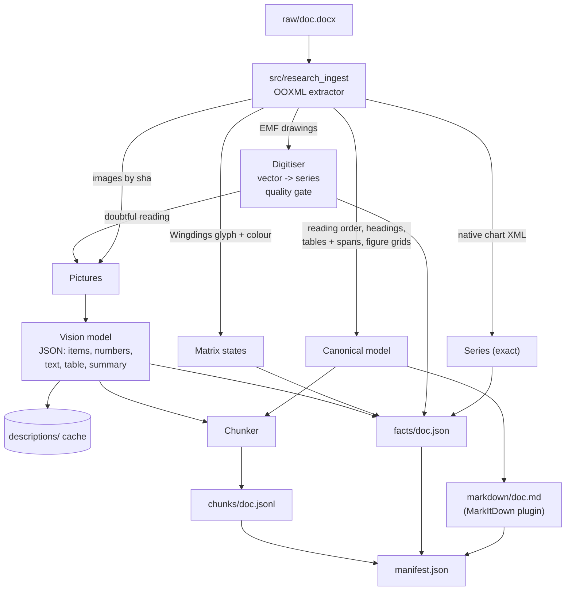
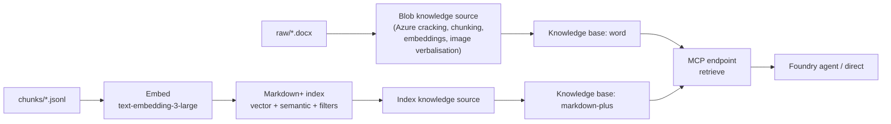
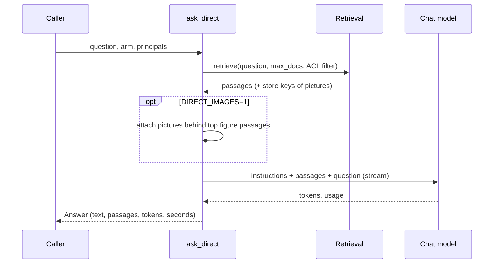
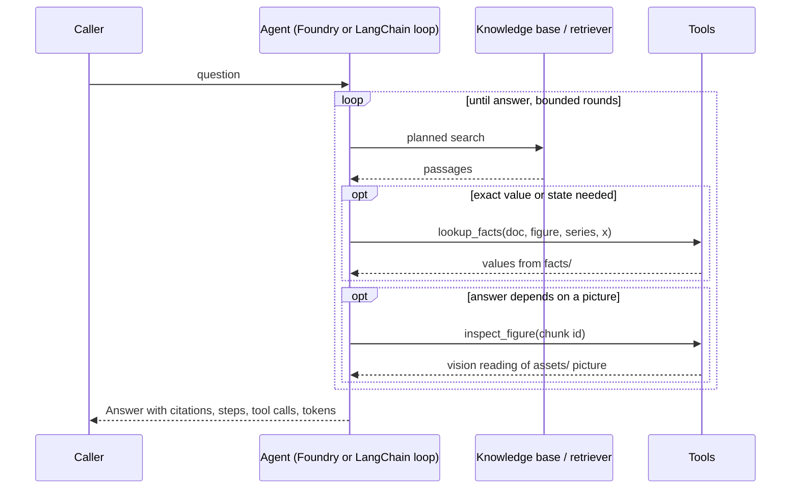
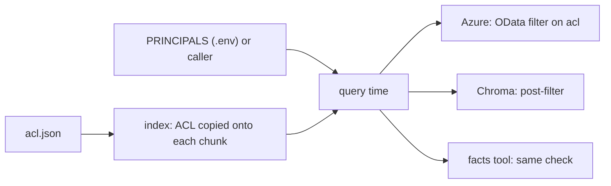
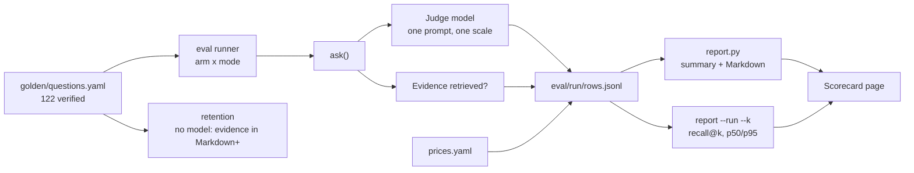
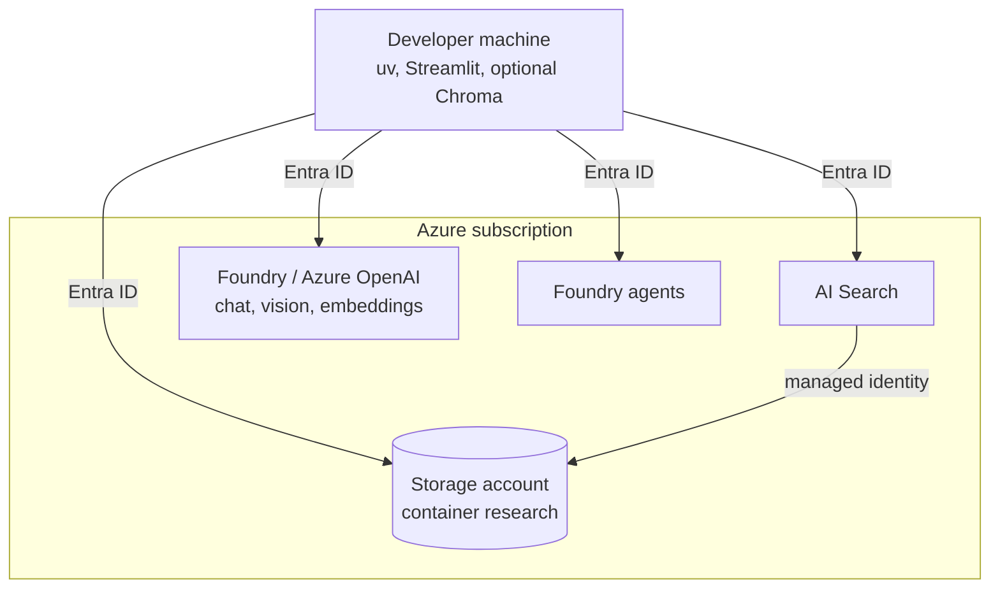

# Technical architecture

*For engineers and architects. Decisions and alternatives: [DESIGN.md](DESIGN.md). Operations: [RUNBOOK.md](RUNBOOK.md).
Business view: [EXECUTIVE_OVERVIEW.md](EXECUTIVE_OVERVIEW.md).*

## 1. Scope and principles

Question answering over Word research reports whose answers live in charts, tick/cross matrices and pictures.

1. **One system of record.** A single Blob container (or a local folder) holds all inputs, derived artefacts and
   evaluation runs. Indexes and Chroma collections are derived and rebuildable.
2. **Convert once, answer cheaply.** Expensive understanding (chart digitisation, vision) happens at ingest and is
   cached by content hash and prompt version.
3. **Exact data beside searchable text.** Markdown for retrieval, a facts file for exact lookups.
4. **Same questions, same judge, every route.** Two arms x two modes x two engines are comparable by construction.
5. **No local paths in any index.** Pictures are referenced by store key.

## 2. System context



## 3. Concepts

| Concept | Values | Meaning |
|---|---|---|
| **Arm** | `word`, `markdown-plus` | Input format. `word` = commodity baseline (Azure Blob ingestion, or stock MarkItDown under langchain). `markdown-plus` = our extraction with facts, assets, vision |
| **Mode** | `agent`, `direct` | `agent`: planning loop with tools. `direct`: one retrieval + one completion (streams tokens) |
| **Engine** | `azure`, `langchain` | `RETRIEVAL_BACKEND`. `azure`: AI Search knowledge bases + Foundry agents. `langchain`: Chroma (vector + BM25, RRF) + a LangChain tool-calling loop |



## 4. Store layout

```
<container>/
  raw/<doc>.docx               input (upload)
  markdown/<doc>.md            Markdown+ with metadata front matter
  assets/<doc>/<sha>.png       pictures rasterised once, named by content hash
  facts/<doc>.json             chart series, matrix cells, picture facts
  chunks/<doc>.jsonl           retrieval chunks with context header
  descriptions/<sha>.json      vision output cache (per picture and prompt version)
  manifest.json                per report: counts, timings, warnings
  acl.json                     optional access list
  eval/<run>/rows.jsonl, report.md, summary.json, baseline-k<k>.md
```

`research_qa/storage.py` exposes one `Store` API with Blob and local-folder implementations.

## 5. Ingest flow



Key behaviours (`research_qa/ingest/`):

| Step | Detail |
|---|---|
| `convert.py` | Word to canonical model; rasterises pictures to `assets/`. MarkItDown is the public interface, the research plugin (`research_ingest.markitdown_plugin`) does the Word step |
| Chart digitisation | Excel charts pasted as EMF are vector drawings; series are read from geometry, validated to within 1% of axis range against the same series published natively; doubtful readings are withheld and sent to vision |
| `describe.py` | Vision prompt v3 returns fixed JSON (items with printed text and counts, labelled numbers, printed text, table transcription, summary). Cached per picture hash + prompt version; `--vision auto|all|none` |
| `facts.py` | Native series, digitised series (marked approximate), matrix cells, picture facts |
| `chunks.py` | Prose grouped by section up to 1,800 chars; a table is one chunk (row-group split with header repeat if long); a figure is one chunk (caption, description, compact series summary, source); metadata block is a chunk; every chunk has a context header (doc id, title, date, section, figure) |
| `pipeline.py` | Idempotent: skips reports already in the manifest unless `--force`; `--doc` selects reports |
| `reconcile.py` | The only deletion path: removes outputs and index/Chroma chunks for documents no longer in `raw/` |

## 6. Indexing and retrieval

### 6.1 Azure engine



- Markdown+ index: `page_chunk`, vector `page_embedding_text_3_large` (HNSW), semantic config, filterable `doc_id`, `date`,
  `kind`, `figure`, plus `assets` (store keys), `has_facts`, `acl`.
- The Word arm index is created and filled by the service. Limitation: files above the tier's cap (16 MB on Basic)
  are skipped. This is a finding about the commodity path; `word-sync` shows per-document results.
- Foundry agents are created per arm (`agents`), each with its MCP connection (`up` does sources, bases and agents).

### 6.2 LangChain engine

- One Chroma collection per arm (`research-<arm>`, cosine), under `CHROMA_DIR`.
- Hybrid retrieval: vector search and BM25 (tokeniser preserves `Fig 27`, `2030`, `CCEP`), 30 candidates each,
  reciprocal rank fusion (k=60). Optional figure boost and Cohere reranker (`RERANKER=cohere`), each an A/B flag
  recorded in every evaluation run.
- The Word arm is the stock MarkItDown conversion (no plugin, no vision, no facts). Size is not a limit.
- One locked Chroma client per process (client construction is not thread-safe and the UI asks arms in parallel).

## 7. Answering flows

### 7.1 Direct mode



### 7.2 Agent mode (Markdown+ arm)



- Both arms share model, reasoning effort and base instructions (`agent/foundry.py`). Common rule: never answer from
  own knowledge; unanswerable questions return exactly `The documents do not say.`
- Tools exist only for Markdown+ because their data does not exist for the Word arm.
- `agent/ask.py` is the single entry point (`ask`) and `run_parallel` runs arms concurrently for the UI.
- Every answer is an `Answer` (`schema.py`): text, passages, steps, tool calls, tokens by kind (input, output,
  reasoning, vision), seconds by phase, errors.

## 8. Access control

`research_qa/acl.py`. `acl.json`: `{"default": ["public"], "docs": {"<doc>": ["group:x", "user:y"]}}`.



No `acl.json` means everything is public. Chunks indexed before the file existed count as public until `index`;
`status` flags it. Principals come from configuration, not from a verified identity token yet (see next steps).

## 9. Evaluation



- Question types: text_fact, table_lookup, image, chart_native, chart_picture, symbol_matrix, relationship,
  cross_document, unanswerable ([golden_set.md](golden_set.md)).
- Run options: `--resume`, `--redo`, `--ids`, `--types`, `--limit`. Name runs by engine.
- `tests/`: baseline-report unit tests and a synthetic-fixture loss report ([audit/02-loss-report.md](audit/02-loss-report.md)).

## 10. Application

| File | Page |
|---|---|
| `app/Overview.py` | Question, latest scorecard per arm, pipeline figure, reports in store |
| `app/pages/1_Ask.py` | Four tiles in parallel threads, streaming for direct, follow-ups, eight golden one-click questions |
| `app/pages/2_Scorecard.py` | Run selection, by type, run vs run, per-question with judge reason |
| `app/pages/3_Reports.py` | Figures redrawn from facts, pictures + descriptions, Markdown, passages, Word-arm view |

## 11. CLI reference

| Command | Purpose |
|---|---|
| `upload <files>` | copy .docx into `raw/` |
| `ingest [--doc] [--vision] [--force]` | Word to Markdown+, assets, facts, chunks, manifest |
| `index [--reset] [--doc] [--arm]` | azure: push Markdown+ index; langchain: build Chroma |
| `knowledge`, `agents`, `up`, `word-sync`, `down` | azure engine objects (sources, bases, agents, Word ingestion, teardown) |
| `ask "<q>" --arm --mode [--no-tools]` | one question |
| `eval --arm --mode --run [...]` | score the golden set |
| `report --run --k` | recall@k and latency, no model |
| `retention` | evidence retention, no model |
| `reconcile [--dry-run]` | remove artefacts of deleted raw files |
| `status` | store and Azure state |
| `app` | print the Streamlit command |

## 12. Configuration (`.env`)

| Group | Keys |
|---|---|
| Store | `STORAGE_ACCOUNT_URL`, `STORAGE_CONTAINER`, `STORAGE_RESOURCE_ID`, or `STORE_LOCAL_DIR` |
| Models | `AZURE_OPENAI_ENDPOINT`, `ANSWER_MODEL` (default gpt-5-mini), `AGENT_REASONING_EFFORT`, `VISION_DEPLOYMENT`, `JUDGE_DEPLOYMENT`, `AZURE_EMBEDDING_*` (text-embedding-3-large, 3072 dims) |
| Engine | `RETRIEVAL_BACKEND`, `CHROMA_DIR`, `RETRIEVAL_FIGURE_BOOST`, `RERANKER` + `RERANK_*`, `DIRECT_IMAGES(_MAX)`, `STREAM_DIRECT` |
| Security | `PRINCIPALS`, `AZURE_OPENAI_API_KEY` (optional; Entra ID otherwise) |
| Cost | `prices.yaml` |

Corporate TLS inspection: `native-tls = true` under `[tool.uv]`; `truststore` is injected at runtime.

## 13. Deployment topology (today)



Roles are granted once per environment by `scripts/setup_access.ps1`; `scripts/runbook.ps1` runs the full bring-up
idempotently.

## 14. Known limits

| Limit | Source |
|---|---|
| Not extracted: comments, tracked deletions, footers; header text only into metadata; body-picture caption not linked to figure number | [audit/02-loss-report.md](audit/02-loss-report.md) |
| Charts whose cached values are absent (external workbook only) are not read | same |
| Word arm on Azure engine skips files above tier cap | [DESIGN.md](DESIGN.md) 3.4a |
| Golden set verified against Word, not published PDFs; four reports only | [golden_set.md](golden_set.md) |
| Principals come from configuration, not a validated token | section 8 |
| Direct-mode token counts rely on usage metadata of the final streamed chunk; rows recorded before that fix have zero tokens and need `--redo` | operations note |
| Streamlit and eval processes must be restarted to pick up code changes | operations note |
